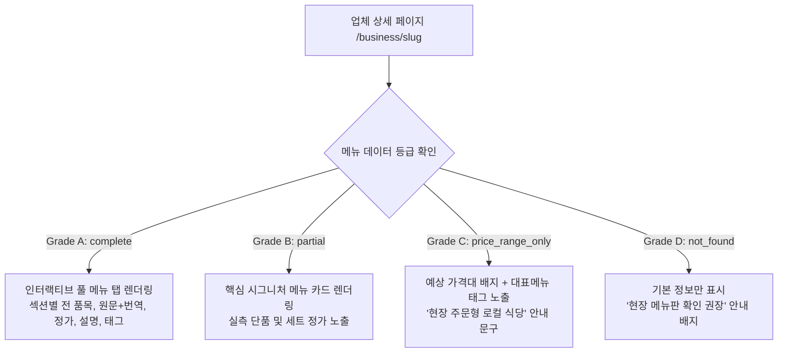

# My Phu Quoc — 데이터 및 메뉴 공통 표준 지침 (Data & Menu Standards)

- **문서 목적**: 웹사이트(My Phu Quoc) 구축 및 컴포넌트·데이터베이스 설계 시 선셋타운 마스터 DB와 검증된 메뉴/가격 데이터를 일관되게 반영하기 위한 공식 표준 지침.
- **적용 대상**: 프론트엔드 UI 컴포넌트, Next.js 페이지, Supabase 스키마, 다국어 렌더링, AI 에이전트(Antigravity, Claude 등)의 모든 개발 작업.

---

## 1. 데이터 소스 참조 원칙 및 파일 맵

사이트 제작 및 데이터 연동 시 반드시 아래 정제된 마스터 파일을 단일 진실 공급원(Single Source of Truth)으로 참조한다.

| 용도 | 참조 파일 | 설명 |
|---|---|---|
| **시설 기본 정보** | [`3_푸꾸옥_선셋타운_전체시설_마스터DB.json`](file:///Users/admin/내 드라이브(namdo772@gmail.com)/PhuQuoc/3_푸꾸옥_선셋타운_전체시설_마스터DB.json) | 291개 시설의 좌표(lat/lng), 주소, 전화번호, SNS, 구글맵 ID, 8대 카테고리 |
| **상세 가이드** | [`4_푸꾸옥_선셋타운_관광시설_종합가이드.md`](file:///Users/admin/내 드라이브(namdo772@gmail.com)/PhuQuoc/4_푸꾸옥_선셋타운_관광시설_종합가이드.md) | 구역별/업종별 관광시설 종합 안내 문서 |
| **개별 메뉴 JSON** | [`menus/{place_id}.json`](file:///Users/admin/내 드라이브(namdo772@gmail.com)/PhuQuoc/menus/) | 각 식음 시설별 표준 규격 JSON (섹션, 품목, 가격, 출처, 검증노트) |
| **메뉴 엑셀 마스터** | [`6_선셋타운_업체별_메뉴_번역본.xlsx`](file:///Users/admin/내 드라이브(namdo772@gmail.com)/PhuQuoc/6_선셋타운_업체별_메뉴_번역본.xlsx) | 요약 시트, 품목별 번역 상세 시트(653개), 가격대 평가 시트, 미확인 시트 완비 |
| **메뉴 통합 가이드** | [`7_선셋타운_업체별_메뉴_번역본.md`](file:///Users/admin/내 드라이브(namdo772@gmail.com)/PhuQuoc/7_선셋타운_업체별_메뉴_번역본.md) | 전체 59개 식당 시설의 전수 조사 결과 및 한국어 번역 마크다운 |
| **진행 현황 메타** | [`menus/_progress.json`](file:///Users/admin/내 드라이브(namdo772@gmail.com)/PhuQuoc/menus/_progress.json) | 수집 진척도, 통계, 등급별 집계 메타데이터 |

> [!CAUTION]
> 초기 수집 시 사용되었던 미검증 추정치 텍스트나 과거 필드는 폐기되었으므로, **반드시 상기 `menus/*.json` 및 `6_선셋타운_업체별_메뉴_번역본.xlsx`에 수록된 검증 데이터만 사이트에 노출**해야 합니다.

---

## 2. 등급별 UI/UX 노출 및 렌더링 규칙

업체의 메뉴 데이터 충실도에 따라 UI 컴포넌트(`components/business/`)는 아래 4단계 등급(Grade) 규칙을 엄격히 준수하여 분기 렌더링한다.



### 1) Grade A (`complete`, 완전 수록 - 6개소)
- **UI 표기**: 상세 페이지 내 **`메뉴 (Menu)` 탭 활성화**
- **노출 내용**:
  - 섹션별 탭/아코디언 (예: `스타터`, `파스타`, `화덕피자`, `참숯 스테이크`, `와인`, `음료`)
  - 메뉴명: 원문(`name_original`) + 한국어(`name_ko`) 2단 병기
  - 요리 설명: 한국어 번역(`description_ko`) 및 주재료 표시
  - 가격: 정확한 정가 표기 (예: `250,000 ₫`)
  - 세금/봉사료 배지: `++ (VAT 및 서비스료 별도)` 또는 `NET (포함)` 명시
  - 식이/알레르기 태그: `채식`, `매운맛`, `추천`, `시그니처` 등

### 2) Grade B (`partial`, 부분 실측 - 10개소)
- **UI 표기**: 상세 페이지 본문에 **`대표 메뉴 & 가격 (Signature Dishes)` 블록 노출**
- **노출 내용**:
  - 현장 영수증 및 메뉴판으로 입증된 핵심 단품 4~10개 카드 형태 렌더링
  - 가격: 실측된 정확한 VND 정가 노출
  - 부가 안내: *"대표 시그니처 메뉴 기준 가격이며, 전체 메뉴는 매장 방문 시 확인 가능합니다."*

### 3) Grade C (`price_range_only`, 가격대 평가 - 33개소)
- **UI 표기**: **`가격대 (Price Range)` 배지 + 대표 요리 키워드 태그 노출**
- **노출 내용**:
  - 1인 또는 메뉴별 실측 가격 범위 (예: `1인 80,000 ~ 180,000 ₫`, `단품 150,000 ~ 380,000 ₫`)
  - 가격 수준 배지: `가성비 로컬 ($)`, `중저가 캐주얼 ($$)`, `중고가 다이닝 ($$$)`, `파인다이닝 ($$$$)`
  - 대표 요리(Known Dishes) 태그: 식당별 주력 메뉴 목록 표시 (예: `#뚝배기생선조림`, `#해산물전골`, `#꽃게찜`)
  - **절대 금지**: 확인되지 않은 세부 단품 항목을 임의로 날조하여 가격표 형태로 만들지 말 것.

### 4) Grade D (`not_found`, 미확인/불일치 - 10개소)
- **UI 표기**: 기본 운영 정보(위치, 영업시간, 전화번호, SNS)만 렌더링
- **노출 내용**:
  - 안내 배지: *"온라인 메뉴판 미제공 매장입니다. 방문 전 전화 문의 또는 매장 현장 메뉴판을 확인해주세요."*
  - 지점 혼선(예: 그랜드월드 지점 중복 등록)이 기록된 경우 주의 문구 표기

---

## 3. 언어 및 명칭 표기 표준 (7개 다국어)

사이트는 7개 언어(`en`, `vi`, `ko`, `zh`, `ja`, `ru`, `hi`)를 지원하므로, 식음료 명칭 표기 시 다음 기준을 따른다.

1. **한국어 (`ko`) 표기 표준**:
   - **기본 포맷**: `음역 + (의미/재료 설명)`
     - 예: `포 따이란 (직화 파기름 볶음 소고기 쌀국수)`, `분보남보 (남부식 소고기 비빔 쌀국수)`, `까 코 또 (뚝배기 생선조림)`
   - **한국 기정착 명칭**: 널리 쓰이는 명칭은 우선 사용
     - 예: `쌀국수`, `반미`, `분짜`, `반쎄오`, `모닝글로리 볶음(공심채 볶음)`
   - **양식/일식/중식 요리**: 외래어 표기법 준수 (예: `카르보나라`, `볼로네제`, `라비올리`, `샤퀴테리`, `로바타야키`, `시샤모`)
2. **다국어 (`en` / `vi` / 기타)**:
   - 영문(`en`): `name_original` 영문 정규명 사용
   - 베트남어(`vi`): 성조가 포함된 정규 베트남어 명칭 사용
   - 기타 언어(`zh`, `ja`, `ru`, `hi`): 원문 명칭과 영어 설명을 기본으로 하되 단계적 AI 검수 번역 적용

---

## 4. 통화 및 가격 렌더링 규격

프론트엔드 포맷터 유틸리티(`lib/utils/format.ts`) 구현 시 다음 규칙을 공통 적용한다.

1. **주 통화 (Primary Currency)**:
   - 베트남 동(VND)을 기본 단위로 사용: `180,000 ₫` 또는 `180,000 VND`
   - 천 단위 구분자(콤마 `,`) 필수 적용
2. **보조 통화 (KRW 환산 참고값)**:
   - 한국어 로케일(`/ko/`) 접속 시 툴팁 또는 괄호로 원화 약값 병기
   - 기준 환율: 100 VND ≈ 5.5 KRW (또는 실시간 환율 API 연동)
   - 표기 예: `180,000 ₫ (약 9,900원)`
3. **싯가(Market Price) 표기**:
   - 활어, 랍스터, 전복, 꽃게 등 무게 단위 주문 품목:
   - 표기: `싯가 (Market Price / theo thời giá)` + `100g 또는 kg당 주문` 보조 설명 표기

---

## 5. Supabase 데이터베이스 연동 스키마 가이드

`supabase/` 마이그레이션 시 메뉴 데이터는 다음 구조로 매핑된다.

```sql
-- 1. 비즈니스 기본 (선셋타운 + 푸꾸옥 전역)
CREATE TABLE public.businesses (
    id UUID PRIMARY KEY DEFAULT gen_random_uuid(),
    place_id TEXT UNIQUE,
    name_display TEXT NOT NULL,
    category TEXT NOT NULL,       -- dining, bars, hotels 등
    sub_category TEXT,
    address TEXT,
    lat DOUBLE PRECISION,
    lng DOUBLE PRECISION,
    phone TEXT,
    website TEXT,
    facebook TEXT,
    instagram TEXT,
    info_level TEXT DEFAULT 'C', -- A, B, C, D
    price_range_min INTEGER,
    price_range_max INTEGER,
    price_range_label TEXT,
    worker_notes TEXT,
    created_at TIMESTAMPTZ DEFAULT now()
);

-- 2. 메뉴 섹션 (카테고리/코스)
CREATE TABLE public.menu_sections (
    id UUID PRIMARY KEY DEFAULT gen_random_uuid(),
    business_id UUID REFERENCES public.businesses(id) ON DELETE CASCADE,
    section_original TEXT NOT NULL,
    section_ko TEXT NOT NULL,
    sort_order INTEGER DEFAULT 0
);

-- 3. 메뉴 품목 (Grade A & B)
CREATE TABLE public.menu_items (
    id UUID PRIMARY KEY DEFAULT gen_random_uuid(),
    section_id UUID REFERENCES public.menu_sections(id) ON DELETE CASCADE,
    name_original TEXT NOT NULL,
    name_ko TEXT NOT NULL,
    description_original TEXT,
    description_ko TEXT,
    price_vnd INTEGER,
    price_note TEXT,
    tags TEXT[],
    is_signature BOOLEAN DEFAULT false,
    sort_order INTEGER DEFAULT 0
);
```

---

## 6. 개발 및 코드 생성 시 필수 체크리스트

모든 에이전트와 개발자는 코드를 작성하거나 수정할 때 다음 항목을 반드시 점검해야 한다.

- [ ] 비즈니스 상세 페이지 구현 시 `info_level` 필드를 확인하여 Grade A/B/C/D별 템플릿으로 분기하는가?
- [ ] 식당 카테고리에서 검증되지 않은 가상의 메뉴 항목이나 임의의 가격을 하드코딩하지 않았는가?
- [ ] 가격 표시 시 항상 VND(`₫`)를 주 단위로 노출하고 환율 환산값은 참고용으로만 처리하였는가?
- [ ] `menus/*.json` 파일과 `6_선셋타운_업체별_메뉴_번역본.xlsx`에 등록된 공식 번역 명칭을 우선 사용하였는가?
- [ ] 세금/서비스료(++) 관련 안내가 누락되지 않았는가?
