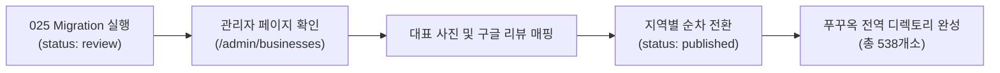

# 🏝️ 푸꾸옥 전역 시설(247개소) 단계적 인제스트 및 운영 가이드

> **작성 일시**: 2026-10-26  
> **관련 마이그레이션**: `supabase/migrations/025_seed_island_candidates_staged.sql`  
> **정제 데이터셋**: `data/phuquoc-candidates-clean.json` (총 262건 중 유효 247건)  
> **검수 리포트**: `data/phuquoc-photon-audit-report.md`  

---

## 1. 개요 및 인제스트 원칙

My Phu Quoc 플랫폼의 1차 오픈 핵심 상권인 **선셋타운(Sunset Town) 291개 마스터 시설**은 이미 `status: 'published'`로 전수 게시되어 안정적으로 운영 중입니다.

본 가이드는 푸꾸옥 전역(중부 즈엉동, 북부 그랜드월드, 중남부 바이쯔엉/소나시, 남부 안터이/사오비치)에서 수집 및 검수 완료된 **247개 유효 상업 시설**을 실서비스 장애 없이 안전하게 데이터베이스에 스테이징(Staging)하고 점진적으로 게시(Gradual Publication)하는 표준 절차를 규정합니다.

---

## 2. 안전 인제스트 3대 원칙 (Zero Conflict)

1. **`status: 'review'` 기본값 부여**:
   - 인제스트되는 247개소는 즉시 공개 웹사이트(`/directory/*`, `/business/*`)에 노출되지 않으며, 관리자(`/admin`, `/editor`) 화면에서만 검토 가능합니다.
   - 기존 선셋타운 291개소의 뷰 및 사용자 경험에 일체의 혼선이나 영향을 주지 않습니다.
2. **멱등성 보장 (`ON CONFLICT (slug) DO NOTHING`)**:
   - 스크립트를 여러 번 재실행하더라도 기존 데이터가 덮어씌워지거나 중복 키 에러가 발생하지 않습니다.
3. **선셋타운 마스터 DB와의 중복 5건 원천 배제**:
   - `Times Corner Amalfi Hotel`, `Luna Folk`, `PH Rooftop Bar`, `La Festa Phu Quoc`, `King Spa` 5건은 이미 마스터에 존재하므로 마이그레이션 대상에서 제외되었습니다.

---

## 3. 지역별 스테이징 시설 현황 (총 247개소)

| 지역 (Region) | 시설 수 | 대표 시설 및 상권 핫스팟 | 주요 카테고리 |
| :--- | :---: | :--- | :--- |
| **Central (즈엉동 / 옹랑)** | **143개** | 즈엉동 야시장, 쩐흥다오 해변 레스토랑, 옹랑 비치 | 식당 41, 바/카페 40, 호텔 35, 스파 22 |
| **North (그랜드월드 / 끄어깐 / 간더우)** | **59개** | 그랜드월드 분수쇼 광장, 빈원더스 배후, 코로나 카지노 | 호텔 25, 바/카페 15, 스파 8, 비치 7 |
| **South (안터이 / 사오비치 / 켐비치)** | **24개** | 사오비치, 켐비치 JW 메리어트, 뉴월드 리조트 | 비치 9, 호텔 7, 바 4, 식당 2, 스파 2 |
| **South-Central (바이쯔엉 / 소나시)** | **21개** | 바이쯔엉 해변 산책로, 소나시 야시장, 노보텔/인터컨티넨탈 | 호텔 11, 비치 5, 식당 3, 바 2 |

---

## 4. Supabase DB 적용 방법

### Option A. Supabase 대시보드 SQL Editor (권장)
1. [Supabase Pro 대시보드](https://supabase.com/dashboard/project/sijozqbgtbmiukqtfblt) 접속.
2. 좌측 메뉴에서 **SQL Editor** 클릭.
3. [`supabase/migrations/025_seed_island_candidates_staged.sql`](file:///Users/admin/내%20드라이브(namdo772@gmail.com)/PhuQuoc/supabase/migrations/025_seed_island_candidates_staged.sql) 파일의 내용을 전체 복사하여 붙여넣기.
4. **Run** 실행 (성공 시 247개 레코드가 `businesses` 테이블에 `review` 상태로 삽입됨).

### Option B. Supabase CLI
```bash
supabase db push
# 또는
supabase migration up
```

---

## 5. 관리자(Admin) 검수 및 점진적 게시(Gradual Rollout) 워크플로우



1. **1차 릴리즈 권장 (남부 & 중남부 45개소)**:
   - 선셋타운과 물리적으로 인접한 안터이 로컬 타운, 사오비치, 켐비치 럭셔리 리조트(JW 메리어트, 뉴월드) 및 바이쯔엉(소나시, 노보텔)을 먼저 `published` 전환.
2. **2차 릴리즈 권장 (중부 즈엉동 143개소)**:
   - 여행자 필수 방문 코스인 즈엉동 야시장 인근 유명 맛집 및 카페/바 공개.
3. **3차 릴리즈 (북부 그랜드월드 59개소)**:
   - 그랜드월드 상권 최종 오픈으로 전 섬 커버리지(538개소) 달성.
